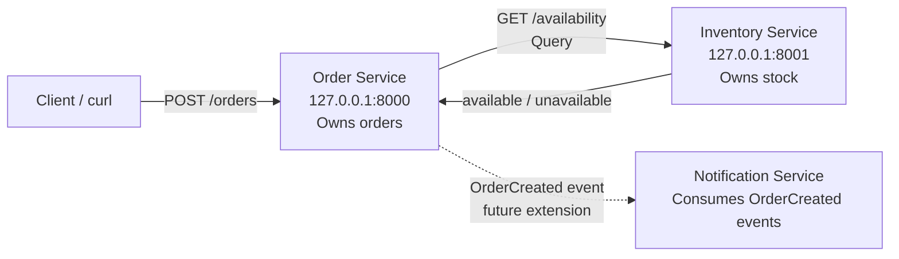
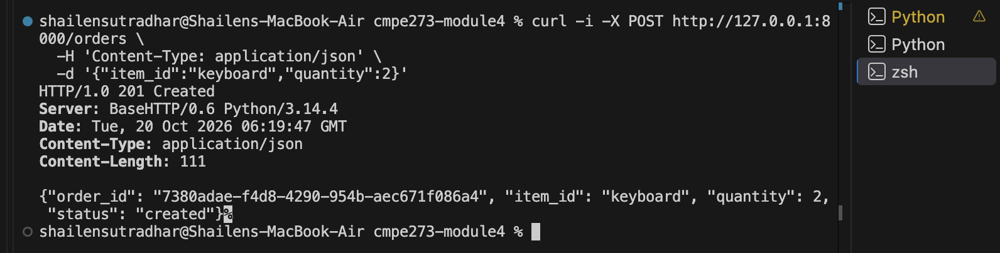
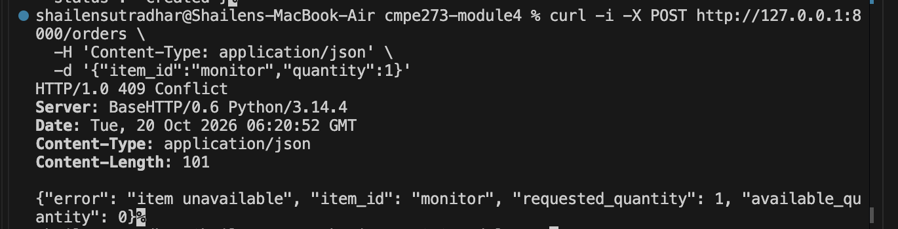
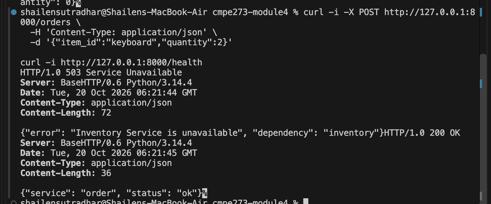

# Module 4 Assignment: Architecture & Service Boundaries

This project implements a small distributed online store in Python using two independent HTTP services: Order and Inventory.

## Architecture



### Responsibilities and data ownership

| Component | Responsibility | Data it owns |
|---|---|---|
| Order Service | Validates order requests, asks Inventory about availability, creates and tracks orders, and returns the result to the client. | Order records: `order_id`, item, quantity, and status. |
| Inventory Service | Answers whether a requested quantity of an item is available. | Item stock quantities. The sample implementation stores them in memory. |
| Notification Service | Represents a future event consumer that would notify users after an order is created. It is shown as a boundary in the architecture but is not required for this interaction. | Notification delivery state and user notification preferences. |

The boundaries follow separate business responsibilities and data ownership. Order Service does not read or modify Inventory's internal data; it uses the Inventory API. This keeps both services independently deployable and prevents notification behavior from becoming part of the synchronous order request.

## Command, Query, and Event

| Interaction | Classification | Explanation |
|---|---|---|
| Check whether an item is available | Query | It reads inventory state without changing it. In this implementation it is `GET /availability`. |
| Create an order | Command | It asks the Order Service to perform a state-changing action. In this implementation it is `POST /orders`. |
| Order was created | Event | It describes something that already happened and can be consumed asynchronously by Notification as an `OrderCreated` event. |

## Installation and running

Requirements: Python 3.9 or newer. There are no third-party dependencies.

Open two terminals in the repository directory:

```bash
python3 inventory_service.py
python3 order_service.py
```

The default ports are Inventory `8001` and Order `8000`. They can be changed with `INVENTORY_PORT`, `ORDER_PORT`, and `INVENTORY_URL` environment variables. Because the services are separate processes, stop only the Inventory process to perform the failure test while the Order process remains running.

## Example requests

The sample inventory contains 10 keyboards, 5 mice, and 0 monitors.

Create a successful order through Order Service:

```bash
curl -i -X POST http://127.0.0.1:8000/orders \
  -H 'Content-Type: application/json' \
  -d '{"item_id":"keyboard","quantity":2}'
```

Expected result: `201 Created`. The response includes a generated `order_id`.

```text
HTTP/1.0 201 Created
{"order_id":"7380adae-f4d8-4290-954b-aec671f086a4","item_id":"keyboard","quantity":2,"status":"created"}
```

An unavailable item returns `409 Conflict` and Order Service remains running:

```bash
curl -i -X POST http://127.0.0.1:8000/orders \
  -H 'Content-Type: application/json' \
  -d '{"item_id":"monitor","quantity":1}'
```

```text
HTTP/1.0 409 Conflict
{"error":"item unavailable","item_id":"monitor","requested_quantity":1,"available_quantity":0}
```

## Failure test: Inventory Service stopped

1. Start both services.
2. Submit the successful request above.
3. Stop the Inventory Service with `Ctrl-C`.
4. Submit the same order again while leaving Order Service running:

```bash
curl -i -X POST http://127.0.0.1:8000/orders \
  -H 'Content-Type: application/json' \
  -d '{"item_id":"keyboard","quantity":2}'
```

Result:

```text
HTTP/1.0 503 Service Unavailable
{"error":"Inventory Service is unavailable","dependency":"inventory"}
```

The `503` is an appropriate dependency-failure response. The Order Service catches the connection error, returns the error to its caller, and keeps listening for future requests instead of crashing.

## Submission screenshots

The terminal evidence for the required scenarios is shown below.

| Filename | Evidence |
|---|---|
| `01-successful-order.png` | Successful `201 Created` order response. |
| `02-unavailable-item.png` | `409 Conflict` response for an out-of-stock item. |
| `03-inventory-failure.png` | `503 Service Unavailable` response after Inventory is stopped, followed by a successful Order Service health check. |

### Successful order



### Unavailable item



### Inventory service failure



Together, these screenshots demonstrate successful order creation, an unavailable item, and graceful handling of an unavailable Inventory Service.

## Reflection

Clear service boundaries make each business capability easier to understand, test, deploy, and change independently. Data ownership prevents services from reaching into one another's storage and reduces accidental coupling. In a distributed architecture, this separation also makes failures and communication contracts explicit, which allows a service such as Order to handle an unavailable Inventory dependency gracefully. Together, boundaries and ownership provide a safer foundation for scaling the system and adding asynchronous consumers such as Notification.
